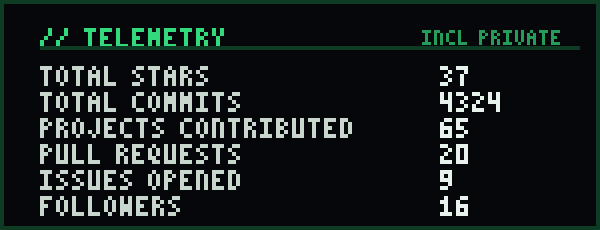
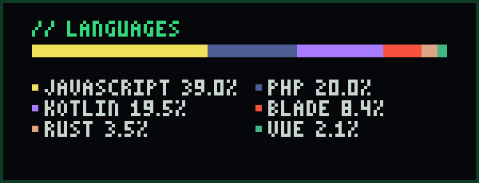

  

## About Me
I build practical software and keep learning by shipping real projects.
My focus is web development (frontend included) and mobile development.

## Tech Stack

  <!-- Frontend -->
  
  
  
  
  <!-- Backend -->
  
  
  
  <!-- Mobile -->
  
  
  <!-- Database -->
  

## What I Like Building
- Web apps with clean architecture and strong UI/UX
- Frontend experiences that feel fast and clear
- Android apps with maintainable Kotlin code
- CRUD systems and API integrations backed by solid MySQL design

## GitHub Stats

  
  

## Let's Connect
- Open to collaboration on web development and Android projects
- Reach me through Issues/Discussions on my repositories
